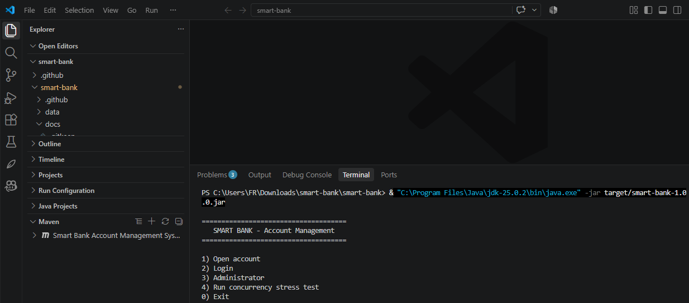
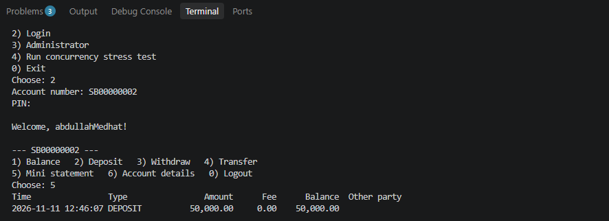
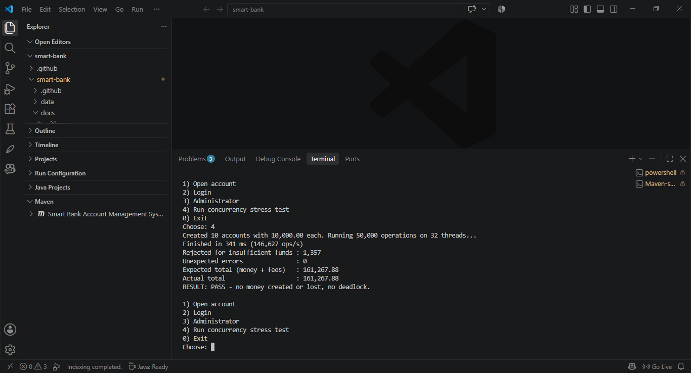
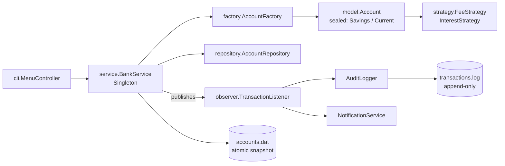

# Smart Bank Account Management System

[](https://github.com/AbDuLLaMedhAtEwiss/smart-bank/actions/workflows/ci.yml)


A thread-safe, file-persistent banking engine with a command-line interface.
Pure Java 21, **zero runtime dependencies** (JUnit 5 for tests only).

## Run it

```bash
mvn test                      # unit + concurrency tests
mvn package                   # builds target/smart-bank-1.0.0.jar
java -jar target/smart-bank-1.0.0.jar
```

Without Maven:

```bash
javac -d out $(find src/main -name '*.java')
java -cp out com.smartbank.Main
```

Menu option **4** runs the concurrency stress test (50,000 random operations on 32 threads) and verifies that
no money was created or lost.

Settings (all optional, pass with `-D`): `smartbank.data.dir` (default `data`), `smartbank.autosave.seconds` (30),
`smartbank.interest.seconds` (30 days), `smartbank.admin.password` (`admin123`, **change it**).

## Screenshots

## Screenshots





## Architecture



```
com.smartbank
├── Main                       wiring, logging, shutdown hook
├── cli/MenuController         input/output only, no business rules
├── service/BankService        the engine: all money operations + locking rules
├── model/                     Account (sealed), SavingsAccount, CurrentAccount, Customer, Transaction (+Builder)
├── factory/AccountFactory     Factory: type -> concrete class
├── strategy/                  Strategy: fee and interest policies per account type
├── observer/                  Observer: AuditLogger, NotificationService
├── repository/                AccountRepository + in-memory implementation
├── persistence/               FileSnapshotStore, FileTransactionLog, codec, in-memory variants for tests
├── security/PinHasher         PBKDF2-HMAC-SHA256, per-account salt, constant-time compare
├── demo/ConcurrencyDemo       stress test with a conservation-of-money invariant
├── exception/                 BankException hierarchy
└── util/Money                 BigDecimal validation / formatting
```

## Concurrency design

| Concern | Solution |
|---|---|
| Lost updates | One `ReentrantLock` per account guards all balance changes (no global lock) |
| Atomic transfer | Both account locks held; debit validated first, credit cannot fail, so no rollback is needed |
| Deadlock | **Locks are always taken in ascending account id.** Transfers and `snapshot()` obey this |
| Consistent snapshot | `snapshot()` holds every account lock (ordered) while copying, so a transfer is never saved half-done |
| Ledger order | Entries are published while the account lock is held, so per-account log order equals real order |
| Id generation | `AtomicLong` for accounts and transactions, `ConcurrentHashMap` for storage |
| Fees counter | `AtomicReference<BigDecimal>` with `accumulateAndGet` |

The stress test checks `sum(balances) + fees == initial + deposits - withdrawals` after the run.
`ConcurrencyTest` also fails (timeout) if the lock ordering is removed, which was verified by mutation.

## Persistence design

* `accounts.dat` is written to `accounts.dat.tmp`, fsync'ed, then moved over the original with `ATOMIC_MOVE`.
  A crash leaves the complete old file or the complete new one.
* `transactions.log` is append-only and flushed per entry. A torn last line is skipped on read and the missing
  newline repaired on open.
* Autosave runs every 30 s, after sensitive events (open account, lockout) and on shutdown (also Ctrl+C).

## Known limits (deliberate, to keep the project readable)

* The ledger flushes but does not `fsync` each entry; an OS crash (not a JVM crash) could lose the last lines.
* `getStatement` scans the log file: O(n). Fine for a CLI, a real system would index by account.
* The admin password is a plain config value; this is a demo, not a production auth system.
* Fee income is tracked in memory since startup and is not persisted.

## Ideas to extend

Virtual threads for the demo (`Executors.newVirtualThreadPerTaskExecutor()`), JSON export of statements,
standing orders via `ScheduledExecutorService`, an HTTP layer on top of `BankService`, a JDBC repository.

## License

MIT, see [LICENSE](LICENSE).
